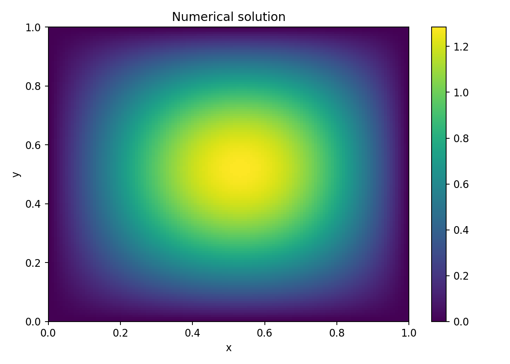
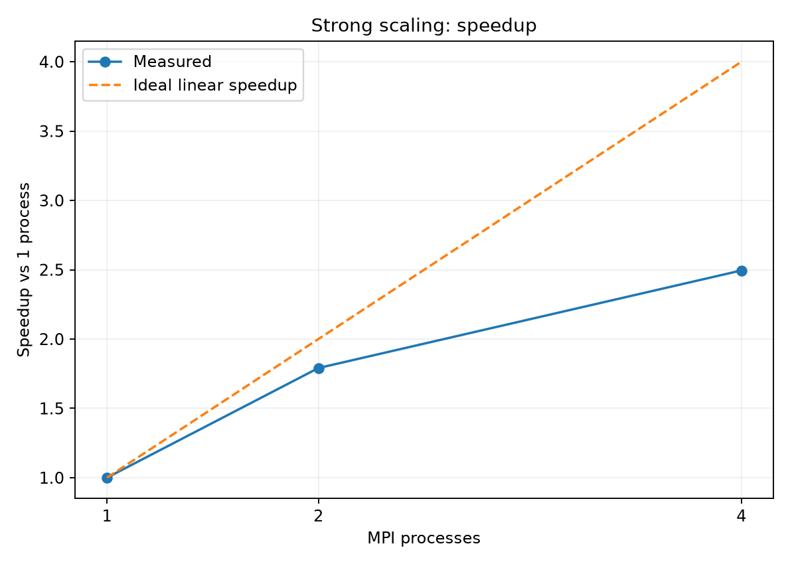
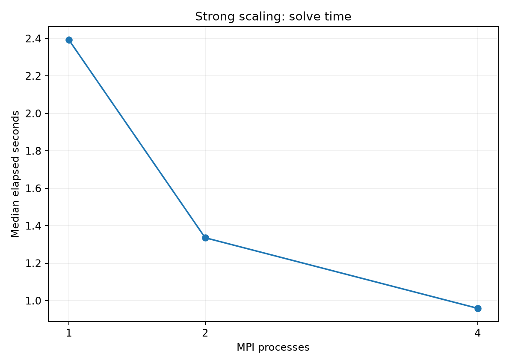

# Parallel Poisson Solver — MPI and Finite Elements

A C/MPI implementation of a distributed **Conjugate Gradient (CG)** solver for the two-dimensional Poisson equation. The project applies numerical methods and parallel-computing concepts from MSc Applied Mathematics HPC coursework at **TU Delft**.



*Solution computed on a 127×127 interior mesh in the single-process validation. Distributed MPI runs are validated separately.*

Features:
- Structured mesh of right triangular **P1 finite elements** on the unit square.
- A **matrix free** stiffness operator, equivalent to the assembled P1 FEM operator on this uniform mesh.
- **Nodal mass-lumped load** and homogeneous Dirichlet boundary conditions.
- 2D MPI Cartesian domain decomposition with an uneven partition supported.
- Ghost cell exchanges using `MPI_Sendrecv`, global dot products using `MPI_Allreduce`.
- Conjugate Gradient solver, wall time benchmark and residual diagnostics.
- Verification using two manufactured solutions and an observed second order discretisation error.

## Problem

Solve

\[
-\Delta u=f\quad\text{in }\Omega=(0,1)^2,\qquad u=0\quad\text{on }\partial\Omega.
\]

The default exact solution used to validate the implementation is

\[
u(x,y)=\sin(\pi x)\sin(\pi y)(1+0.3x+0.15y+0.2xy).
\]

The forcing is obtained analytically as \(f=-\Delta u\). The smooth manufactured solution avoids the trivially one-iteration CG solve of a single discrete sine eigenmode.

**Important numerical scope:** The code exploits the fact that the assembled P1 stiffness operator on *this particular uniform right-triangle mesh* has a five-point stencil. See [numerical details](docs/numerics.md).

## Dependencies

Ubuntu or WSL Ubuntu with a C compiler, `make`, Python 3, and an MPI toolchain:

```bash
sudo apt update
sudo apt install -y build-essential openmpi-bin libopenmpi-dev python3
```

## Build and run

```bash
make
mpirun -np 1 ./bin/poisson_mpi --nx 63 --ny 63
mpirun -np 4 ./bin/poisson_mpi --nx 63 --ny 63 --px 2 --py 2
```

`--nx` and `--ny` are numbers of *interior* nodes per direction; the boundary is at 0 and 1. MPI chooses a process topology automatically if `--px/--py` are omitted. Custom topology is supported, including uneven partitions. Sample output (values shown are from a **single process smoke test computation**, not an MPI benchmark):

```text
RESULT nx=31 ny=31 ranks=1 px=1 py=1 case=mixed iterations=67 converged=1 relative_residual=8.144055441e-11 true_residual=8.143871427e-11 l2_error=5.152332297e-04 rel_l2_error=8.063973723e-04 linf_error=1.040886758e-03 time_sec=...
```

The `RESULT` record is machine-readable and contains MPI process count, topology, iterations, true residual, L2 error, maximum error, and elapsed time (maximum across MPI ranks). **Converged** means the iterative residual is below the threshold; the manufactured solution tests separately check the mathematical error.

## Validation

```bash
make test
```

Tests run on 1, 2 and 4 MPI ranks, compare alternative decompositions against a single rank, check non-square grids, inspect distributed output completeness and verify second-order numerical convergence under mesh refinement.

For a CPU-only single-process smoke test on a machine without MPI:

```bash
make smoke
```

This fallback validates mathematical logic **but does not exercise real MPI communication**; use `make test` for parallel validation.

## Numerical convergence (single-rank smoke test)

| Interior grid | L2 error | CG iterations |
|---|---:|---:|
| 15 × 15 | 2.064e-3 | 31 |
| 31 × 31 | 5.152e-4 | 67 |
| 63 × 63 | 1.288e-4 | 138 |
| 127 × 127 | 3.219e-5 | 279 |

The L2 error decreases by approximately a factor of four per grid refinement, as expected for this smooth problem. These values were directly computed using the single-rank test executable; they are not MPI speedup measurements.

## Visualise the numerical solution

```bash
mkdir -p results figures
mpirun -np 4 ./bin/poisson_mpi --nx 127 --ny 127 --px 2 --py 2 \
  --output-prefix results/solution
python3 -m pip install -r requirements-plots.txt
python3 scripts/plot_results.py --solution-prefix results/solution --output-dir figures
```

Each process writes only its own interior nodes. The plotting script combines rank CSVs and checks for duplicated/missing nodes. It creates `figures/solution.png` and `figures/absolute_error.png`.

## Strong scaling (measure on your own machine)

```bash
python3 scripts/benchmark.py --nx 255 --ny 255 --ranks 1 2 4 --repeats 3
python3 scripts/plot_results.py --scaling-csv results/strong_scaling.csv --output-dir figures
```

The benchmark measures **actual** solve times and computes speedup and efficiency relative to a single process. It writes raw runs to `results/strong_scaling.csv` and can plot the timing and speedup curves. Small problems can run slower on more processes because communication and global reductions are relatively expensive; no speedup is assumed in advance.

## Measured MPI strong scaling

Benchmarks performed under Ubuntu/WSL in November 2026.

| Interior grid | MPI ranks | Median time (s) | Speedup | Efficiency |
|---|---:|---:|---:|---:|
| 255 x 255 | 1 | 0.209 | 1.00x | 100% |
| 255 x 255 | 2 | 0.159 | 1.31x | 65.6% |
| 255 x 255 | 4 | 0.129 | 1.62x | 40.5% |
| 511 x 511 | 1 | 2.392 | 1.00x | 100% |
| 511 x 511 | 2 | 1.336 | 1.79x | 89.6% |
| 511 x 511 | 4 | 0.959 | 2.50x | 62.4% |

The smaller grid uses three repetitions per configuration;
the larger grid uses five. Results report median solve times.

The larger workload shows better parallel scaling, reaching
a 2.50x speedup with four MPI processes. Scaling remains
sublinear because of communication and synchronisation overhead.

Single-rank timing variability is substantial, so these results
should be treated as indicative measurements rather than
hardware-independent performance guarantees.





## Methods and implementation notes

For the grid with spacings \(h_x\) and \(h_y\), the FEM interior stiffness row is

\[
(Au)_{ij}=2(c_x+c_y)u_{ij}-c_x(u_{i-1,j}+u_{i+1,j})-c_y(u_{i,j-1}+u_{i,j+1}),
\quad c_x=h_y/h_x,\;c_y=h_x/h_y.
\]

The mass-lumped load is \(b_{ij}=h_xh_y f(x_i,y_j)\). CG uses neighbor exchange on each sparse matrix-vector multiply, plus global reductions for inner products. See [docs/numerics.md](docs/numerics.md) for derivation, algorithmic limits, and validation criteria.

## Portfolio context and provenance

Developed around the mathematical and parallel computing topics studied in the TU Delft HPC course: Poisson's equation, finite elements, MPI domain decomposition, neighbour communication and collective reductions. This standalone implementation does not redistribute course-provided source code or assignment handouts. If you adapt the source or reuse a third-party component, retain its attribution and applicable license terms.

## Project layout

```text
src/poisson_mpi.c          Solver and MPI domain decomposition
scripts/benchmark.py      Repeated real-MPI strong-scaling runs
scripts/plot_results.py   Plot saved solver and performance results
tests/test_solver.py      Black-box mathematical and MPI tests
tests/mpi_shim.*          Single-process fallback for non-MPI environments
.github/workflows/       Automated build and MPI tests
```
